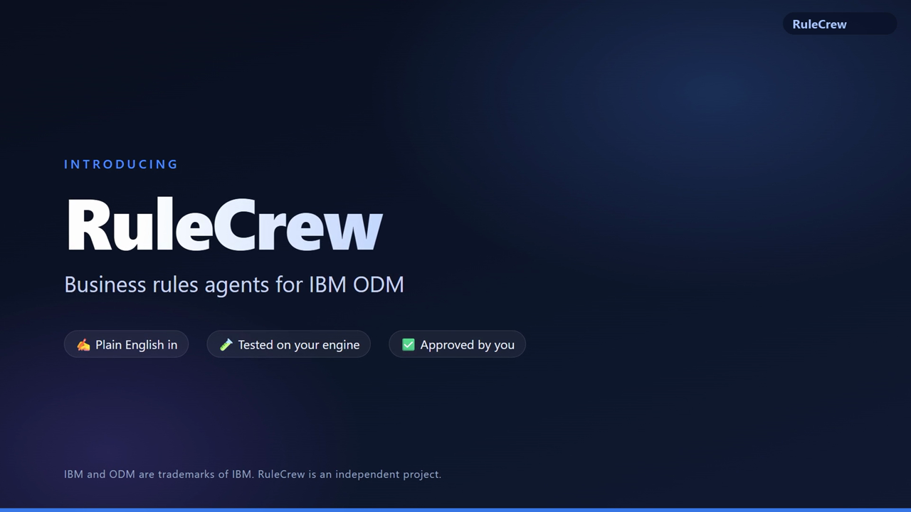

# RuleCrew

**Business rules agents for IBM ODM.** Describe a rule change in plain English. A crew of AI specialists
analyses it, designs it, builds it, tests it on your own engine and reviews it - and nothing is written until a
person approves the exact change.

▶ **[Watch the product tour (7 min)](RuleCrew_tour.mp4)**

## What you will see
- **A real request, end to end** - "refuse the loan when the amount is more than ten times the borrower's yearly
  income" on a working branch of a loan-validation decision service.
- **The crew at work, live** - orchestrator, business analyst, architect, developer, tester, reviewer, independent
  critic and release manager, several of them working in parallel.
- **A safety net** - the independent critic stopped a condition nobody asked for, and the crew asked a person
  before going on.
- **Your approval** - the exact change, every warning and a Definition of Done: compiled with your ODM build,
  test suites passed, existing decisions replayed before and after, reviewed twice.
- **Before and after**, **every agent traced**, and the audit trail.

## Why a crew
Rule-writing assistants generate new rules from a prompt and leave the checking to you. Changing a *live*
application needs more - the requirements, the existing rules and their dependencies, regression, review and
approval. On a complex rule application, with many projects, rule flows, decision tables and dependencies, each
specialist checks a different risk.

## Works with
- IBM ODM 9.0 and later (tested on 9.6)
- Decision Center, Rule Execution Server (or an embedded engine), or a local Rule Designer workspace folder
- Runs on your own machine; works with the model provider you choose
- IDE assistants through the Model Context Protocol

## Status
A working prototype, shown on IBM's sample loan application. We would love your feedback - open an issue in this
repository.

---
*IBM, ODM, Decision Center and Rule Execution Server are trademarks of International Business Machines
Corporation. RuleCrew is an independent project, not affiliated with or endorsed by IBM.*
